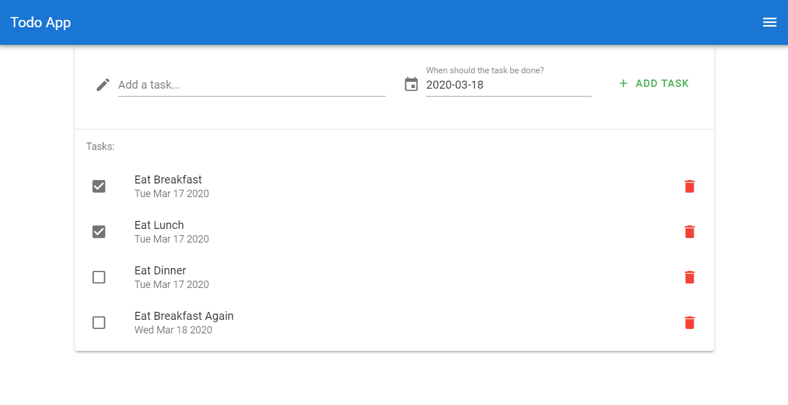

:)

# Lab 5B - Vue.js Front-End App

As with all labs, you should read the instructions to the end before getting started.

## Overview
This lab is a direct continuation of Lab 5A. In the previous lab, you completed the first component, `AppBar.vue`. For this lab, you will create the remaining two components: `TaskList.vue` and `TaskForm.Vue`.

In Lab 5A we gave you two pre-built Vue components and we walked you step-by-step through building another. In this lab we will give you a functional description of each of the two new components but you will build them, either from scratch or with the help of your favorite AI LLM.

This example places the due date under the task description. You can organize however looks pleasing to you.

### Functionality

- Front-end only framework that communicates with a backend

### Concepts

- Vue.js
    - Ref variables
    - Components
        - Props
        - Emits
        - Models

### Resources

- [What is Vue?](https://vuejs.org/guide/introduction.html)
- [Vue Quick Start](https://vuejs.org/guide/quick-start.html)
- [What is Vite?](https://www.hostinger.com/uk/tutorials/what-is-vite)
- [Vue Extension for VS Code](https://marketplace.visualstudio.com/items?itemName=vue.volar) (Optional VS Code extension)

## Step 1: Build and Integrate a TaskList.vue Component

Here is the **Functional Description:**

The TaskList.vue component should retrieve the complete list of tasks from the REST API from Lab 4B and should display the tasks in rows. Each task should have a checkbox for marking it complete, text that describes the task, a due date, and a delete icon to remove the task from the list. When a task is marked is complete, the text should have a `line-through` decoration. When a task is marked (or unmarked) as complete the API should be called and the display should be updated. Likewise, when a task is deleted, both the API and the display should be updated.

1. Using the examples and the Vue documentation create a `TaskList.vue` file in your `components` subdirectory.

2. Fill in the component with basic functionality. A good way to start is to ask your favorite AI LLM to create the component for you. In preparing this lab, we used the following prompt successfully:

> Create a Vue 3.4+ component. It should use <style scoped> and <script setup>. The component should display a list of tasks that it retrieves from an API. The API call returns a JSON list of JSON objects. Each object has four properties: _id, text, done, and date. _id is a number, text is the text of the task, done is a boolean, and date is of type date. The task list display should have four columns. The first column a checkbox corresponding to "done", the second column is the text of the task, the third column is the due date of the task, the fourth column should show a Unicode trash can glyph which will later be connected to a delete function.

You may choose to embellish this prompt. For example, you might describe the APIs needed to update and delete the task and ask the AI to implement those functions. Or you might ask the AI to implement the `line-through` style when a task is marked as completed. You can try doing this all with one prompt or with successive prompts.

Another successful technique is to paste in code you already have working and ask the AI to update it to add features.

3. Add the component to your `App.vue` main application page.

Hint:
* Use the AppBar as an example of how to place the component.

4. Test and fix any problems.

Hints:
* Make sure your calls to `fetch()` include `credentials: 'include'` or they will not supply the authentication cookie.
* If your database does not have any tasks in it, you can create some using `callapi.html` as described in Lab 4.
* If your dates are off by one day it may be that your code is parsing the JSON date as UTC and rendering it in local time or vice versa.

(Now is a good time to commit - push.)

## Step 2: Build and Integrate a TaskForm.vue Component

**Functional Description:**

The TaskForm.vue component should display a form with the following parts: A text input for the task description, a date input for the due date, and an "Add Task" button. Each of the two inputs should have a label. When you click the "Add Task" button the component should ensure that the inputs have valid values before calling the REST POST API to add a new task. After a task has been added, the inputs should be cleared in preparation for adding another task.

**Important:** Upon completing step, the **TaskForm** and **TaskList** will be independent of each other. So, after adding a task, you will have to refresh the page before the new task will show in **TaskList**. You will connect the two components in Step 3.

Hints:
* If you use `<input type="date">` then the browser will automatically give you a date selector.
* You should create Vue `ref` variables for the task *text* and *date* and then use `v-model` to bind them to the corresponding input elements. Then, those variables are conveniently available for the REST POST call.

As with the TaskList control, you can have AI build the initial version and then you can clean it up. This time, it's up to you to compose the AI prompt.

Create the component, add it to your App.vue, and test everything. Remember to refresh the page after adding tasks.

(Now is a good time to commit - push.)

## Step 3: Notify the TaskList when the TaskForm adds a task.

This step will use three important Vue features: Ref variables, Emits, and Props:

Below is a refresher. But if these features are totally unfamiliar, you should check out the [Vue Walkthrough](https://byu-itc-210.github.io/walkthrough/Vue) from this course and/or the official [Vue Quick Start](https://vuejs.org/guide/quick-start.html)

* **Ref:** A Vue `ref` variable can notify code and components when its value changes. In JavaScript, you access the value of a `ref` variable through `.value`. For example, I might declare a variable as follows: `const count = ref(4);`. Then I could update the value like this: `count.value = 6;`. Or I could increment the value like this: `count.value++`;
* **Prop:** A Vue `prop` is a *property* passed into a Vue component. Typically it is a value that affects how the component looks or behaves. A `prop` can be a simple value such as a number or a string. When a `ref` variable is assigned to a `prop` then the component can react when the value of the variable changes.
* **Emit:** A Vue `emit` is a value or event that a component can send to its owner. Components use emits to indicate when something has happened or when a value has changed.
* **Model:** Vue 3.4 introduced `model`. Underneath the hood, it combines `prop` with `emit` thereby enabling two-way communication. When a `ref` variable is assigned to a `model` in a component then the component will respond to changes in the variable and the variable will be updated when component changes its value.

The `SwdDrawer.vue` component uses `model` to connect `open` status with its owner.

Do the following with help from examples, Vue documentation, and AI:
1. Add a Vue `emit` called `added` to `TaskForm.vue`. Cause the emit to be fired each time a task is added.
2. Add a Vue `prop` called `update` to `TaskList.vue`. Its type should be `Number`. Cause the task list to reload from the database each time the value of `update` changes.
3. In `App.vue` create a `ref` variable called `update` and `v-bind` that variable to the `TaskList` `update` prop.
4. In `App.vue` create a function called `taskAdded()` that increments the value of the `update` `ref` variable. Connect the `taskAdded()` function to the `TaskForm` `added` emit.

Hints:
* Since you want `TaskList.vue` to react to changes in the `update` variable, you should use `v-bind:` or its colon shorthand: `<task-list v-bind:update="update">` or `<task-list :update="update">`
* To connect the `taskAdded()` function to the `added` emit, use `v-on:` or its at-sign shorthand: `<task-form v-on:added="taskAdded">` or `<task-form @added="taskAdded">`
* Since `update` is a `ref` variable. You increment its value as follows: `update.value++;`

Test everything, commit - push.

## Step 4: Make it Look Good

Add or augment the CSS to make this all look good. You may copy CSS rules from your Lab 1. Follow your own taste. You can keep it simple, go neon, or do anything in between. (See the pass-off requirement for expectations.)

Hints:
* If you put a CSS rule in a `<style scoped>` section of a Vue component, it is isolated to the template of that component. No other component, including child components, will see that CSS rule.
* You can intentionally make a `<style scoped>` CSS rule visible to children. Look up Vue "deep selectors" if you want to know more.
* If you put a CSS rule in a `<style>` section of a Vue component (without the `scoped` attribute) then that rule will be global -- applying to parents, peers, children, everywhere. One Vue component can have both `<style>` and `<style scoped>` elements.
* You can use a conventional CSS stylesheet. In `main.js` add this line: `import './assets/styles.css';` substituting the appropriate absolute or relative path to your stylesheet.

Need we say it? Commit - push.

## Step 5: Go Live

Deploy your updated task list to your GitHub Pages site.

1. 'npm run build'
2. Copy the `dist` directory to your GitHub Pages Repo
3. On the GitHub Pages Repo `commit - push`
4. Wait a minute or two. GitHub pages do not update instantly.

## Passoff

Before contacting a TA for passoff, check all of the following on your app.

- [ ] 5 Points - First commit is on or before Friday.
- [ ] 5 Points - Source code is pushed to GitHub.
- [ ] 5 Points - The application is running on a live GitHub Pages website.
- [ ] 10 Points - Your app shows a task list with the required elements: 'done' checkbox, task text, due date, and a delete icon.
- [ ] 5 Points - Clicking the 'done' checkbox marks it as done and sets the text to `line-through`.
- [ ] 5 Points - Clicking the 'delete' icon removes the task from the list.
- [ ] 10 Points - Done and delete operations are saved in the database. If you refresh the page the state doesn't change.
- [ ] 10 Points - You can add a task by entering the information into the form and clicking 'Add'.
- [ ] 5 Points - Both the visible task list and the database update when you add a task.
- [ ] 5 Points - The application looks good. That is, there is more to the look than plain HTML or what the AI generated.

## Extra Credit

> Remember: TAs cannot help you with extra credit!

- [ ] 20 Points - Show user's Google photo and name instead of their email in the drawer.
  - This is the same extra credit as with Lab 5A. You can only count it once!
- [ ] 20 Points - Add functioning *Sort by date* and *Filter completed tasks* toggles like those in Lab 2A.
    - [ ] 10 More Points - Perform the *Sort by date* and *Filter completed tasks* operations in the back end. The front end should indicate sorting and filtering options in the appropriate REST call. (While doing this on a todo app is unnecessary, performing those operations at the back-end and database levels is essential in apps with large data sets.)

## Writeup Questions

- Did you use AI to create the initial TaskList and/or TaskForm components? How close did it come to the final version? What kind of changes did you make to the AI-generated code?
- Did the AI make mistakes in its code? If so, how much time did you spend correcting those problems?
- If you were creating a new web application, how would you use AI as part of the process?
